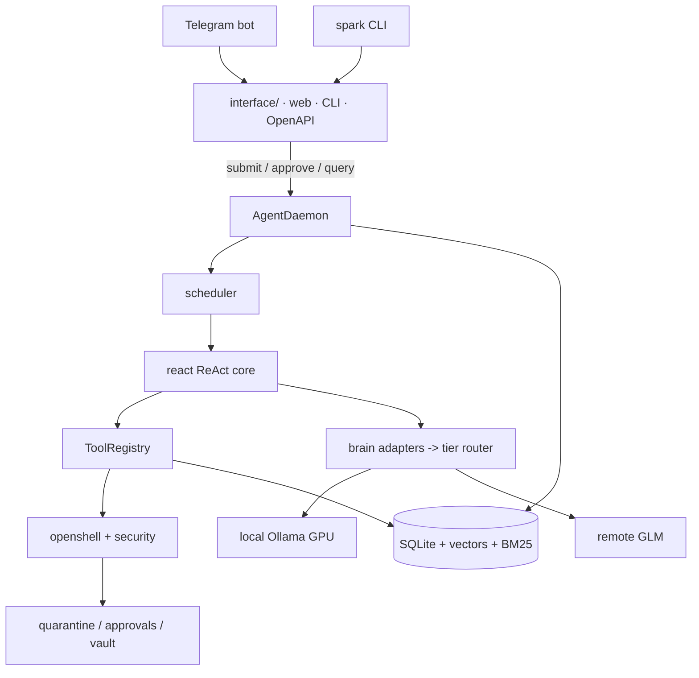

# Architecture



SparkAgent is a 24/7 asyncio daemon composed of independently supervised
subsystems. This page is the map; each package has its own page.

```
                 ┌─────────────────────────────────────────────┐
 Telegram ──────▶│ interface/  web dashboard · CLI · OpenAPI   │
 CLI ───────────▶│             (loopback-guarded transports)   │
                 └──────────────────┬──────────────────────────┘
                                    │ submit / approve / query
                                    ▼
┌──────────────┐ ┌─────────────────────────────────────────────┐
│ kernel/      │ │ AgentDaemon                                  │
│  config      │ │  ├── scheduler ──▶ react ──▶ ToolRegistry   │
│  bus         │ │  ├── memory (SQLite + vectors + BM25)       │
│  metrics     │ │  ├── health / heartbeat / audit-persist     │
│  circuit ... │ │  └── supervised loops (backoff restarts)     │
└──────────────┘ └───────┬─────────────────────────┬───────────┘
                         ▼                         ▼
              ┌──────────────────┐      ┌──────────────────────┐
              │ brain/           │      │ tools/ + swarm/      │
              │ adapters→router │      │ registry · skillforge│
              │ local(GPU) first│      │ stdlib · swarm roles │
              │ remote fallback │      └──────────┬───────────┘
              └──────────────────┘                 │ spawn/fetch
                                   ▼               ▼
                         ┌──────────────────────────────┐
                         │ openshell/ + security/       │
                         │ profiles · policy · vault    │
                         │ approvals · quarantine ·     │
                         │ prompt guard · signatures    │
                         └──────────────────────────────┘
```

## Layers

1. **OpenShell / security** — everything that touches the machine or the
   outside world. Program allowlists, denylists, path confinement,
   SSRF-guarded fetch, approval workflow, quarantine.
2. **Brain** — provider-agnostic `ChatAdapter`s behind a tier router with
   per-tier circuit breakers, response cache, cost accounting, and a VRAM
   veto for the local GPU tier.
3. **Tools & swarm** — the agent's hands. The registry validates and
   audits every call; SkillForge lets the agent extend itself; the swarm
   package composes planner/worker/critic/synthesizer pipelines.
4. **Kernel** — the ReAct state machine, scheduler, memory (SQLite WAL +
   hybrid BM25/vector recall), metrics, health, tracing, and the
   supervised daemon loop.

## Invariants

- Every loop runs under a supervisor with exponential backoff — a bug in
  one subsystem degrades it, never the daemon.
- Every credential flows environment → vault → consumer, redacted at
  every logging boundary.
- Every byte of untrusted text passes the prompt guard before reaching a
  model prompt; high-risk content is quarantined, not delivered.
- Every SQL statement is parameter-bound; no exceptions.

## Capability → guarded path (ADR-0010)

Every capability has exactly one guarded implementation; the tool, HTTP
endpoint, CLI, and Telegram surfaces are thin adapters over it.

| Capability | Guarded implementation | Guards that live inside |
|---|---|---|
| Read-only db lookups | `tools/sqlite_query.lookup()` | static statements, `mode=ro`, Python-side filtering |
| Backup lifecycle | `ops/backup.py` functions | hash verification before restore, size cap, retention |
| Quarantine | `security/quarantine.QuarantineStore` | total-size budget, TTL sweep, sanitize-on-release |
| Web fetch | `tools/webfetch.WebFetcher.fetch` | SSRF validation per hop, size cap, prompt guard |
| Auth | `security/auth_limiter.AuthRateLimiter` | failure window, lockout, expired-lockout cleanup |
| Task write path | `kernel/memory.py` task methods | parameter-bound SQL, dependency cycle walk |
| Agent memory | `kernel/memory.py` remember/recall/forget | empty-text validation, kind scoping |
