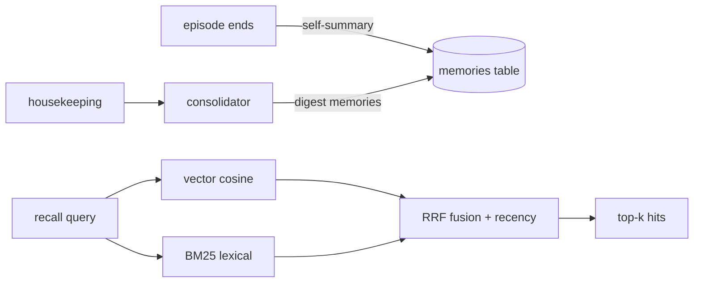

# Memory

SparkAgent remembers in layers, all in one SQLite database (WAL mode)
plus derived indexes — every statement parameter-bound.

## Stores

| Table/Index | Content |
|---|---|
| `episodes` / `steps` | goals, outcomes, and every thought/action/observation |
| `memories` | distilled facts with embeddings (vector recall) |
| `tasks` | scheduler queue: one-shot, interval, daily |
| `audit` | every execution, tool call, approval, quarantine action |
| `BM25Index` | lexical index over `memories` (identifiers, rare terms) |
| `GraphStore` | subject–predicate–object triples with provenance |

## Recall: hybrid by default

A query runs both channels — cosine similarity over embeddings and BM25
over the text — fused with **Reciprocal Rank Fusion**
(`score = Σ 1/(60 + rank)`), then a small recency boost (14-day half
life). Vectors come from Ollama embeddings when the local tier is up,
else a deterministic hashing embedder (words + bigrams → 384-d, L2
normalized) — no download required, upgradeable in place.

Why hybrid: hashes/vectors blur "0x80070005" into noise; BM25 nails
exact rare tokens but misses paraphrases. RRF gets both without tuning
score scales.

## Consolidation

`memory_search/summarizer.py` extracts the k best sentences per episode
(TF-IDF salience × position × query focus, redundancy suppressed by
Jaccard) and folds batches into a single distilled memory. The
housekeeping loop prunes steps/episodes beyond `retention_days`.

## Entity graph

`graph.add("sparkagent", "uses", "ollama")` builds a directed multigraph
with adjacency indexes, dedupe (weights upgrade on repeat), k-hop
traversal, and JSON-lines persistence. `facts_about(node)` renders
human-readable lines for prompts.

## What the agent sees

New episodes inject the top-`recall_k` hybrid hits into the system prompt
(`Relevant long-term memories`), and finished episodes write a
self-summary back as a `kind="episode"` memory. The `remember` and
`recall_memory` tools let the model file and search memories explicitly.
