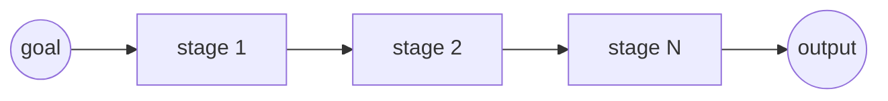
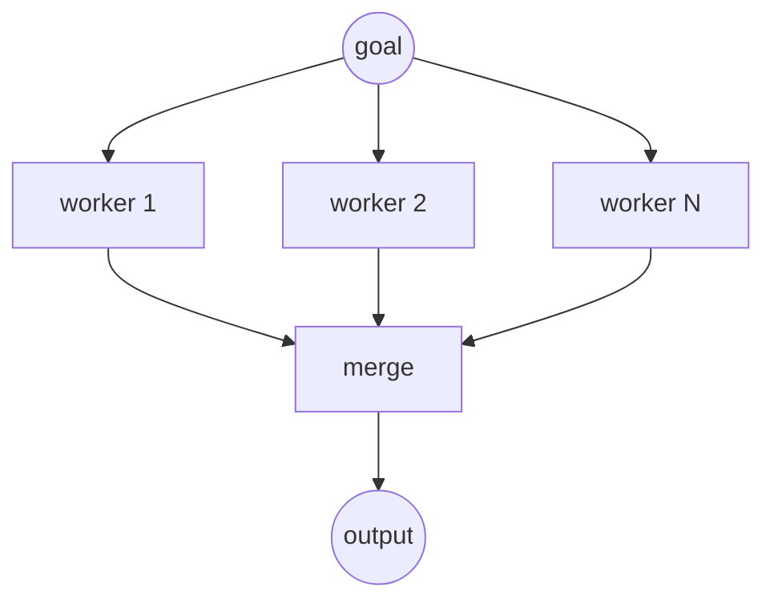
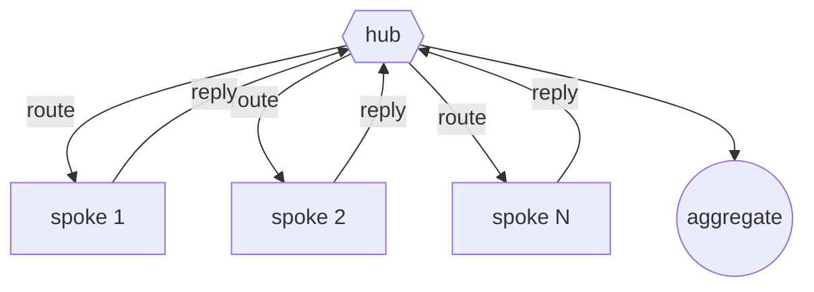
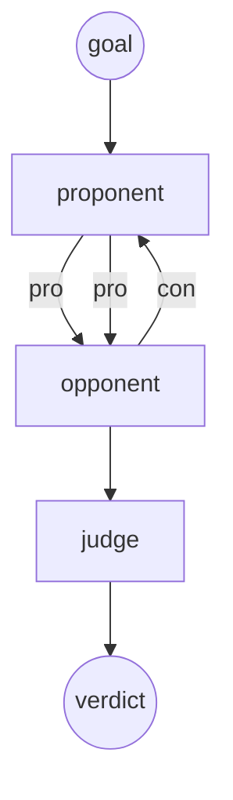
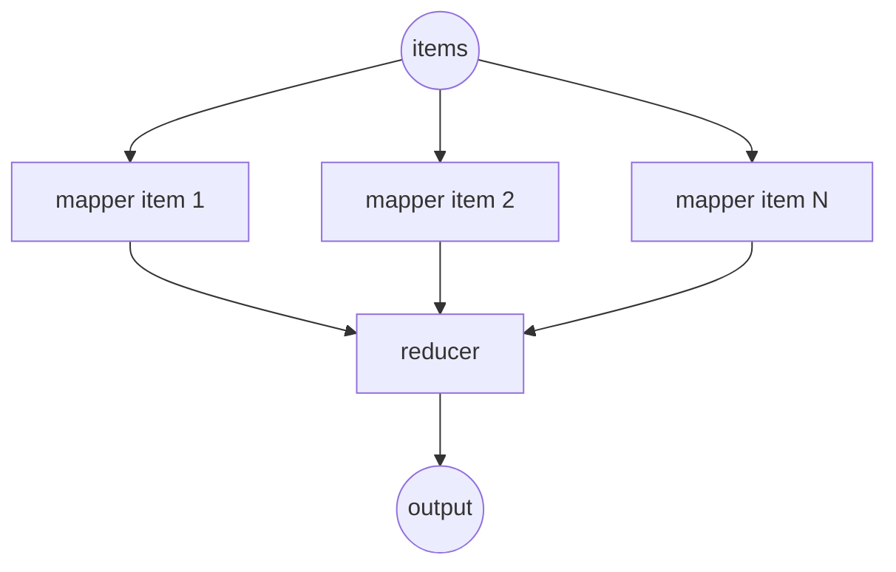

## Topology catalog

Served as JSON (with these diagrams) at `GET /api/swarm`.

### `sequential`

Pipeline: each stage's output feeds the next stage as context.

### `parallel`

Fan-out: workers answer the same input, a merge function folds the replies.

### `star`

Hub-and-spoke: the hub routes, spokes answer, the hub aggregates.

### `debate`

Adversarial: alternating proponent/opponent rounds, then a fair settlement.

### `map_reduce`

Mapper over each item, reducer folds mapped outputs into one answer.

